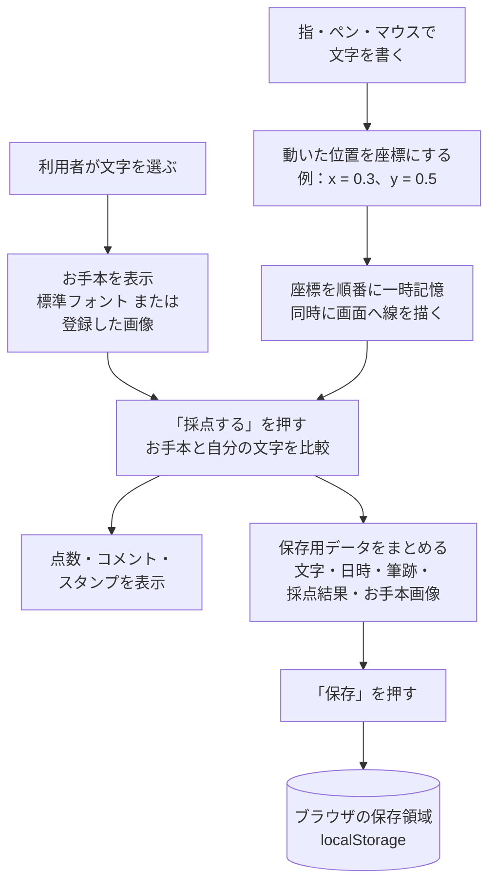
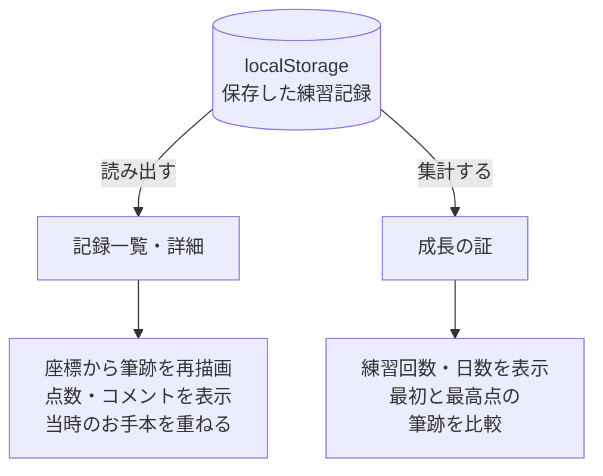
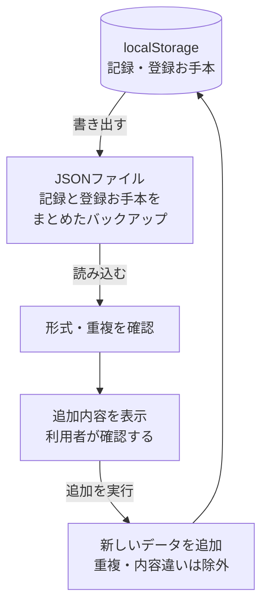
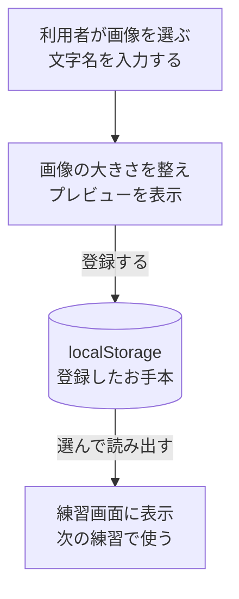

# 美文字ログ：データの流れを図で理解する

プログラムを学び始めた方向けの資料です。2026年11月16日時点の実装をもとにしています。

このアプリは、**ブラウザの中で、手書き → 採点 → 保存 → 振り返りまで行います**。現在のコードでは、練習データを外部サーバーに送る処理はありません。

図の矢印は「データが渡される方向」を表します。操作を表す枠には、ボタン名なども記載しています。

## ① 書いた文字が保存されるまで

### 「座標」「一時記憶」「保存領域」とは？

| 言葉 | 初学者向けの説明 | このアプリでの使い方 |
| --- | --- | --- |
| 座標 | 場所を数値で表したもの | ペンが通った場所を、横方向の `x` と縦方向の `y` で記録します。 |
| 一時記憶 | 作業中の机のような場所 | 書きかけの線や、まだ保存していない採点結果を置きます。ページを再読み込みすると消えます。 |
| localStorage | ブラウザ内の引き出しのような場所 | 「保存」を押した練習記録や、登録したお手本を残します。再読み込み後も読み出せます。 |
| Canvas（キャンバス） | プログラムで絵や線を描ける画面上の領域 | 自分の筆跡やお手本を表示します。 |

座標は `0〜1` の割合で記録します。左上が `x = 0、y = 0`、右下が `x = 1、y = 1`、中央が `x = 0.5、y = 0.5` です。表示する大きさが変わっても、同じ比率で筆跡を描き直せます。

### 採点では何を比べる？

採点はブラウザ内のJavaScriptが計算します。

- **総合点**：お手本と自分の文字の「位置・大きさ・縦横比」を比べて計算します。
- **形状点**：位置と大きさをそろえ、線の形の近さを別に計算します。総合点には含めません。
- **改善コメント**：位置・大きさ・縦横比の比較結果に応じて決めます。
- **スタンプ**：総合点に応じて選びます。

文字の正誤や書き順、とめ・はね・はらいを判定する仕組みではありません。

**「採点する」と「保存」は別の操作です。** 採点だけではlocalStorageに記録されません。

## ② 保存したデータを使う仕組み

横に広がりすぎないよう、用途別に3つの図に分けています。枠内の文章も短く改行しています。各図の「localStorage」は、同じ保存先を表します。

### A. 記録と成長を振り返る

自分の筆跡は**「点の並び」**、お手本は**「採点したときの画像」**として保存します。後からお手本を変更しても、過去の練習を当時のお手本と見比べられます。

記録を開いたときは、保存済みの点数やコメントを表示します。毎回採点し直すわけではありません。「成長の証」の最高点は、総合点をもとに選びます。

### B. バックアップを書き出す・読み込む

**JSON（ジェイソン）**は、データを文字としてまとめる書き方です。このアプリでは、練習記録と登録したお手本を1つのファイルに入れて書き出します。

読み込み時は、記録のIDやお手本の文字名をもとに既存データと比較します。同じものや、同じID・文字名で内容が違うものは読み飛ばし、新しいデータを追加します。

保存先は**同じサイトを開いている、その端末・ブラウザの保存領域**です。別の端末やブラウザへ自動で同期する機能はありません。移す場合は、書き出したJSONファイルを移動先で読み込みます。

### C. 自分のお手本画像を登録する

画像はブラウザ内で処理し、PNG画像を文字列に変換して保存します。練習の採点時には、そのときのお手本画像を練習記録にも残します。そのため、登録お手本を後で削除しても、保存済みの練習記録のお手本は残ります。

## ③ コードの担当を知る

JavaScriptは、画面上の操作を受け取り、計算・保存・表示を動かすプログラムです。このアプリでは、役割ごとにファイルを分けています。

| ファイル | 担当すること |
| --- | --- |
| [app.js](../js/app.js) | ボタン操作を受け取り、描画・採点・保存などの担当へ処理を渡す。練習中の一時データも管理する。 |
| [characters.js](../js/characters.js) | 標準で選べる文字の一覧を用意する。 |
| [canvas-drawing.js](../js/canvas-drawing.js) | 入力位置を座標に変換し、筆跡を描く。保存した座標からの再描画や、お手本の重ね合わせも行う。 |
| [evaluation.js](../js/evaluation.js) | 位置・大きさ・縦横比を比較し、総合点・改善コメント・スタンプを決める。 |
| [shape-evaluation.js](../js/shape-evaluation.js) | 線の形を比較して、形状点を計算する。 |
| [records.js](../js/records.js) | 練習記録の内容確認・読み書き・削除・並べ替え・集計を行う。 |
| [record-views.js](../js/record-views.js) | 記録一覧や成長比較の表示を組み立てる。 |
| [templates.js](../js/templates.js) | 登録お手本の内容確認・読み書き・削除を行う。 |
| [backup.js](../js/backup.js) | 記録と登録お手本をまとめてlocalStorageへ保存する。JSONバックアップの書き出し・読み込みも行う。 |

現在は `backup.js` を通して、記録と登録お手本をlocalStorageの `bimoji.data.v1` という名前の保存枠にまとめています。`records.js` と `templates.js` は、それぞれのデータの扱い方を担当します。

## 保存について覚えておくこと

- **一時記憶と保存済みの記録は別です。** 後から見返すには、採点後に「保存」を押します。
- **保存した筆跡は座標から描き直します。** 一覧用の小さな画像を別に保存する必要はありません。
- **ブラウザの保存データを消すと記録も消えます。** 手元に残したいデータは、JSONファイルとして書き出せます。
- **画面の見た目と保存データは別です。** 記録の絞り込みや並べ替えは、元の練習内容を書き換える操作ではありません。
